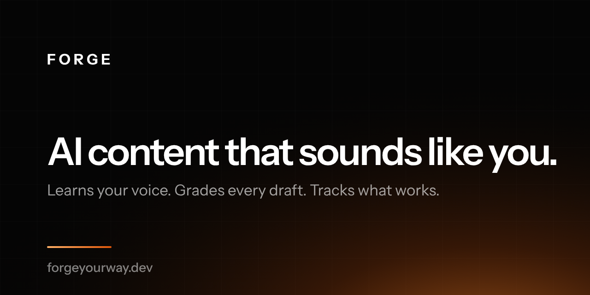
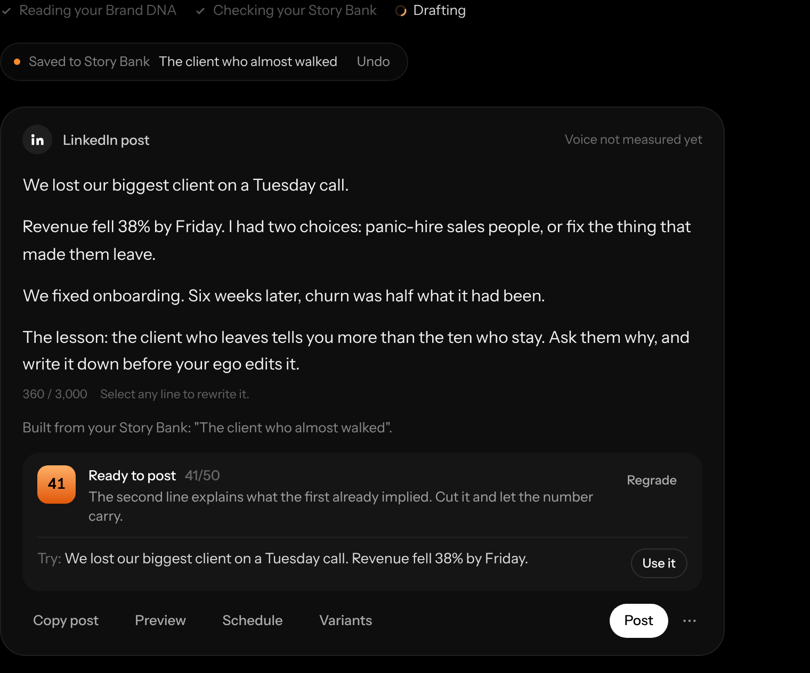
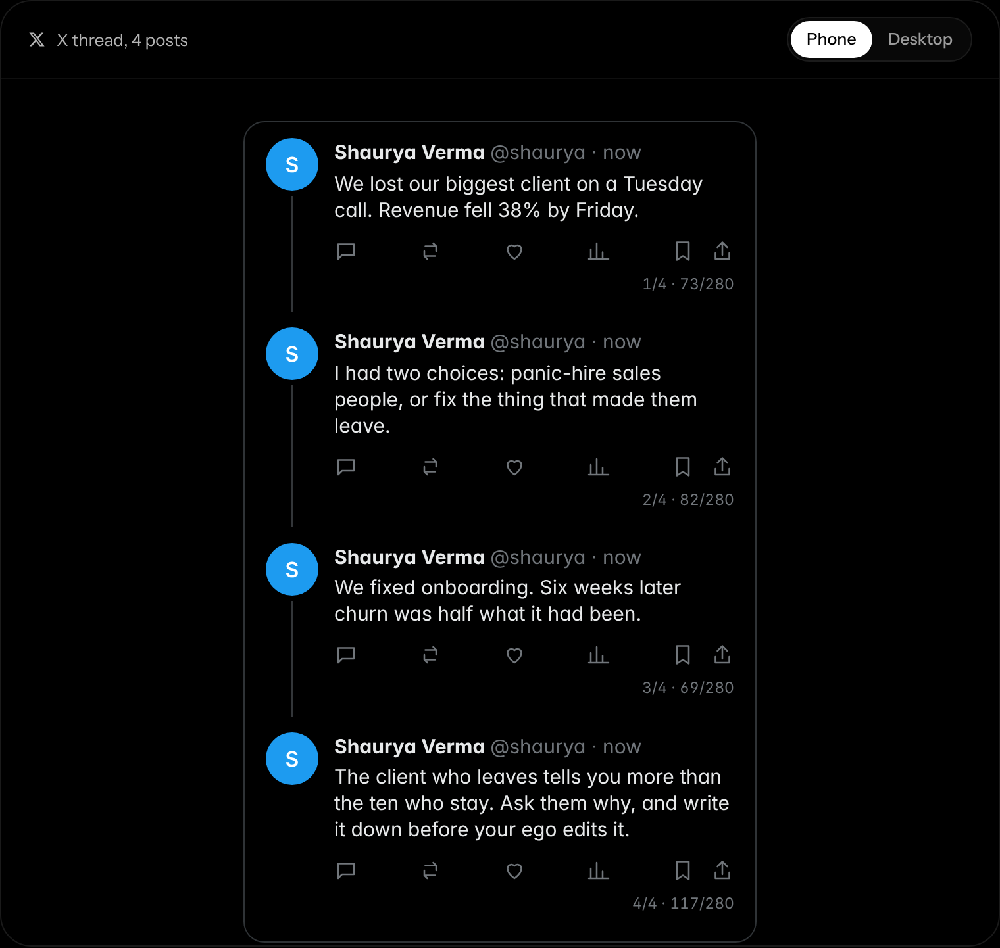
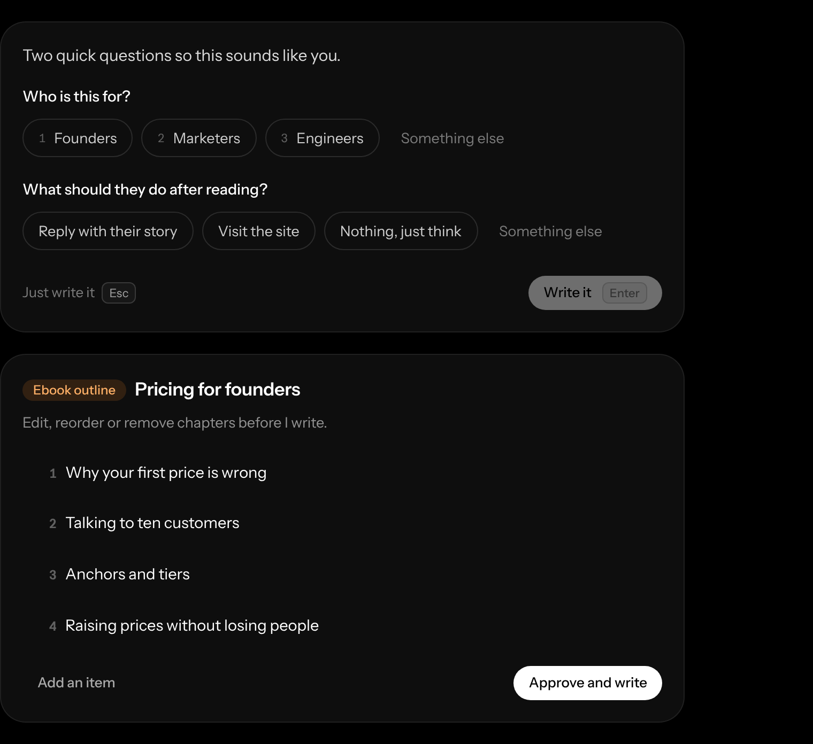
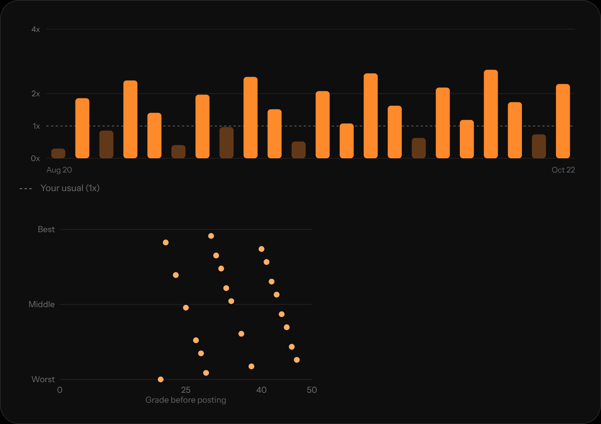

<p align="center">
  
</p>

# Forge

Forge writes posts that sound like the person publishing them, grades every draft before it goes out, and learns from what actually performed.

It is built around four ideas that a general-purpose chatbot does not have:

- **A measured voice.** Sentence length, line breaks, punctuation and openings are measured from the writer's own posts. Every draft is scored against that fingerprint line by line as it is edited.
- **Only true material.** A Story Bank of the writer's real stories, numbers and opinions. Forge searches it before drafting and writes `[brackets]` where a fact is missing instead of inventing one.
- **A grade before posting.** Five dimensions, the single weakest thing, and one rewrite, on a fixed rubric.
- **A loop.** Drafts are linked to the live post, results are collected at 1 hour, 24 hours and 7 days, and the Playbook reports what works for this writer, with the sample size behind every finding.

How each score is produced, and its limits, is documented on the [methodology page](app/(marketing)/methodology/page.tsx).

| | |
| --- | --- |
|  |  |
|  |  |

## What is in the box

**Capture.** Material comes to Forge instead of the other way round: voice notes recorded in the browser or the installable app (with a home-screen shortcut that starts recording), recorded interviews with a question guide aimed at what the Story Bank lacks, a private email-in address, sharing from any phone app, the extension, and read-only connectors for GitHub, Linear, Notion and calendars. Forge transcribes and reads each one and proposes stories, numbers and opinions; the person keeps, edits or discards each. Nothing reaches the Story Bank without that decision.

**This week.** Every week, at the hour the person chose in their time zone, Forge drafts the week from the idea queue (captures, the Story Bank, audience questions, posts worth running again, the niche), slots each draft into one of their best times, and says how each is likely to do. Review is a swipe deck on the phone or a list on the desktop; approving schedules, skipping returns the idea to the queue.

**Chat.** Streaming replies with visible progress, clarifying questions as tappable chips (keys 1 to 4, Enter to send, Esc to skip), outlines to approve before long generations, drafts as cards, memory you can see and undo, `/grade`, `/thread`, `/carousel`, `/variants` and `/story` commands, and `@` mentions that pull a story from the Story Bank. 23 tools behind the + menu, gated by plan from one table.

**Drafts.** Inline editing with live voice scoring and drift markers, select any line to make it punchier, shorter, more like you or strictly true, five graded variants, platform previews (X, LinkedIn with its "see more" fold, Threads, Bluesky, Instagram, newsletter), scheduling against the writer's own best times, and a library with a "worth reposting" view.

**Publishing.** LinkedIn and Threads over OAuth, Bluesky with an app password, optional automatic publishing at the scheduled time. X drafts open X's own composer: Forge never needs write access to an X account and never posts or replies on its own.

**Results.** Automatic collection from X, Bluesky, Threads and LinkedIn (where the analytics scope is granted), or typed in, or read from a screenshot and confirmed. The Playbook, grader calibration against real outcomes, and opt-in anonymous niche insights with a minimum of five contributors per pattern.

**Predictions, experiments and goals.** Before posting, a range for how the draft is likely to do against the writer's usual, from their most similar past posts, with how often those ranges have been right. Weekly experiments test one variable at a time across the plan and are judged by a permutation test on the writer's own results. Tracked links and Cal.com, Calendly or webhook connections attribute bookings, sign-ups and purchases to the post that led to them.

**Visuals and repurposing.** Any draft renders as a quote card, statement image, list or carousel in the brand's kit, downloadable as PNG or as a PDF for LinkedIn documents. A newsletter, talk or transcript becomes a set of posts across platforms, each linked back to the passage it came from.

**Formats and long form.** Shared formats are the structure of a post that worked with every fact removed; using one writes a draft from the user's own Story Bank. Their results are shown only from five or more opted-in people. Guides and short books are compiled from the writer's best posts and stories, chapter by chapter, with every chapter traced to its material.

**Comment inbox.** Comments on published posts in one place, a reply drafted in the writer's voice for them to post, and questions from the audience fed into the idea queue.

**Signals.** A free public X profile audit with shareable result pages, niche pulse, Reply Radar (drafted replies, posted by the user from X's reply box), and competitor watch with a weekly email digest.

**Teams.** Client workspaces (one shared voice) and company workspaces (each person's own voice under the brand's rules), with owner, editor, reviewer and client roles. The draft studio has live co-editing over Supabase Realtime with a Yjs document merged on the server, comments on exact words, version history with restore, and an activity log. Results by person, no-login client approval links, monthly client reports at a private link, and SAML single sign-on.

**API and MCP.** Scoped API keys (read, write, generate), optionally pinned to one workspace, for a REST API under `/api/v1` and an MCP server at `/api/mcp` with tools to read the voice, check text against it, grade an opening, search and save stories, list ideas and drafts, and draft a post. Drafts made this way are saved for review, never posted.

**Account.** Download every record and uploaded file as one zip, delete the account (billing cancelled, work in other people's workspaces kept with them), notification preferences by email and push, connected accounts, API keys and invoices.

**War Room.** A researcher, strategist, writer, red team and editor work through a campaign brief in turn and return graded drafts.

**Extension.** A Chrome extension that grades the composer on X, LinkedIn, Threads and Bluesky, fills it with an approved draft at a click (the person presses Post), and saves selections to Forge. See [`extension/README.md`](extension/README.md).

**Instrumentation.** A fixed vocabulary of product events, never content, and an internal `/admin` page with daily active people, the path from capture to publishing, how much of each draft people rewrite, plan approval, and weekly retention cohorts.

## Stack

Next.js 14 (App Router, TypeScript strict), Tailwind, Framer Motion, Zustand, Supabase (Postgres with row level security, Storage, Realtime), Yjs, Anthropic (Claude Haiku 4.5, prompt caching), Groq for the fallback model and Whisper transcription, Upstash Redis for rate limits, Tavily for web research, the X API v2, Resend (outbound and inbound), Web Push, Razorpay.

## Getting started

```bash
npm install
cp .env.example .env.local      # fill in at least the REQUIRED values
npm run dev
```

### Database

Apply the migrations in `supabase/migrations/` in order, in the Supabase SQL editor or with `supabase db push`. Each is additive and idempotent. [`docs/UPGRADE.md`](docs/UPGRADE.md) lists what each one changes and the project settings it needs.

`supabase-schema.sql` is the original baseline. The production project also holds billing objects (`plan_limits`, `get_quota_status`, `reserve_quota`, `settle_quota`), the calendar, ebooks and email preference tables, which were created before migrations were tracked in this repository; a fresh project needs those too.

### Scheduled jobs

Jobs are plain HTTP endpoints called by Supabase `pg_cron` with `Authorization: Bearer $CRON_SECRET`. They refuse to run without the secret. The exact `cron.schedule` statements are at the end of the migration.

| Job | Schedule | Does |
| --- | --- | --- |
| `/api/cron/publish-scheduled` | every 5 minutes | Publishes drafts scheduled with "Publish automatically" |
| `/api/cron/calendar-reminders` | every 5 minutes | Emails scheduled posts at their reminder time |
| `/api/cron/post-metrics` | every 30 minutes | Collects results at 1 hour, 24 hours and 7 days |
| `/api/cron/niche-insights` | daily | Recomputes anonymous niche patterns and shared format results |
| `/api/cron/competitor-digest` | Mondays | Emails the competitor watch digest |
| `/api/cron/weekly-plan` | hourly | Writes each brand's week at its chosen hour, then emails and pushes |
| `/api/cron/sources-sync` | every 6 hours | Reads connected GitHub, Linear, Notion and calendars into the inbox |
| `/api/cron/comments-sync` | every 2 hours | Reads comments on recent posts |
| `/api/cron/client-reports` | monthly | Builds each client workspace's report for the month before |

### Platform apps

- **X**: an app-only bearer token (`X_BEARER_TOKEN`). Used for reads only.
- **LinkedIn**: register `<APP_URL>/api/connections/linkedin/callback`; products Sign In with LinkedIn using OpenID Connect and Share on LinkedIn. Add `r_member_postAnalytics` to `LINKEDIN_SCOPES` once approved.
- **Threads**: register `<APP_URL>/api/connections/threads/callback`; permissions `threads_basic`, `threads_content_publish`, `threads_manage_insights`.
- **Bluesky**: nothing to register.

Platform credentials are encrypted with AES-256-GCM under `FORGE_ENCRYPTION_KEY` before they reach the database, and the table that holds them has no client-readable policy.

## Project layout

```
app/
  (marketing)/            landing page, free audit, shared grades, methodology
  (dashboard)/dashboard/  the workspace: chat, inbox, this week, drafts, brand, signals, playbook, formats, team, calendar, ebooks
  capture/  review/       the installable app's capture and swipe review screens
  drafts/[id]/            the draft studio: live editing, comments, versions, visuals, results, origin
  onboarding/             first-run setup
  approve/[token]/        client approval page (no account needed)
  r/[token]/              monthly client report (no account needed)
  invite/[token]/         workspace invitations
  admin/                  internal usage insights
  api/                    route handlers; one folder per resource
components/forge/         the app's UI system and feature components
lib/forge/                domain logic: grading, voice, learning, playbook, publishing, metrics, capture,
                          weekly plan, prediction, experiments, goals, formats, long form, MCP
lib/platforms/            LinkedIn, Threads and Bluesky clients
lib/x/                    X API client, audit, niche pulse, Reply Radar
extension/                Chrome extension (Manifest V3)
supabase/migrations/      schema changes
```

Domain logic lives in `lib/forge` and is pure where it can be (voice scoring, edit learning, the Playbook's statistics, text measurement), so it runs identically on the server and in the browser. Route handlers authenticate, validate with zod, call into `lib`, and return; they do not hold business logic.

## Conventions

- Every model call on a user's behalf reserves and settles quota through `lib/forge/metered.ts` or the chat route.
- Plan gates come from `lib/forge/entitlements.ts`, which the server enforces and the UI renders.
- Public endpoints that spend money upstream are rate limited per visitor and capped per day.
- Nothing is posted to X automatically, ever. No automated likes, follows or replies anywhere.
- Formatting: Prettier (`.prettierrc`), TypeScript strict, no emoji in UI copy.

## License

Copyright SHV Groups Pvt Ltd. All rights reserved until a license is published.
