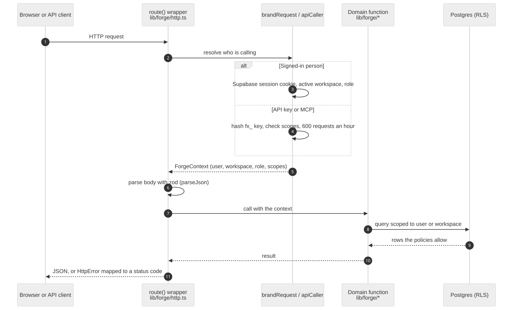
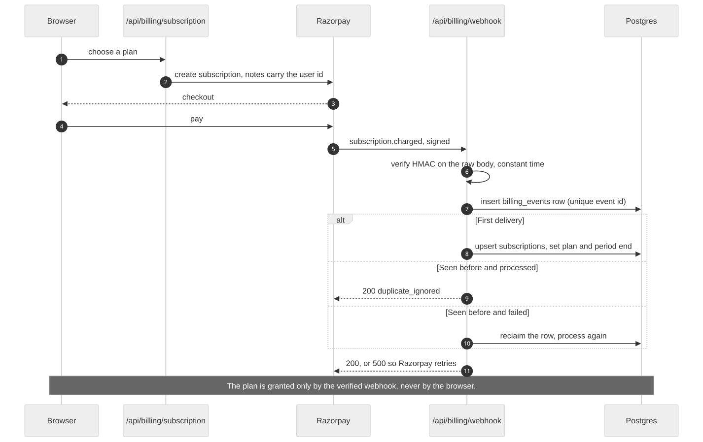

# Forge architecture

This is the map of how Forge is built. Read it before [ONBOARDING.md](./ONBOARDING.md). Every diagram has its Mermaid source next to it in [`docs/diagrams/`](./diagrams), so you can edit and re-render them (`npx @mermaid-js/mermaid-cli -i x.mmd -o x.svg`).

## 1. What Forge does, in one paragraph

Forge turns what a person actually did (voice notes, emails, GitHub releases, finished Linear issues, meetings) into posts written in their own measured voice. It keeps a bank of true stories, ranks them into an idea queue, writes a weekly plan of drafts, grades the opening of each one, predicts a likely range from the person's own past posts, publishes or hands off to the person, then reads back the results and learns. Teams and agencies get shared workspaces, approvals and client reports. Other software can use the same engine through a REST API and an MCP server.

## 2. Size and shape

| Area | What lives there | Approx. lines |
| --- | --- | --- |
| `app/` | Next.js App Router: 32 pages, 128 API route handlers | 20,900 |
| `components/` | React UI, including the legacy editor and ebook canvas | 16,900 |
| `lib/` | Domain logic (`lib/forge`), Supabase clients, email, SEO | 24,500 |
| `supabase/` | Three migrations for the current platform | 1,900 |
| `extension/` | Chrome extension (Manifest V3, plain JS) | 600 |

## 3. System context



- **One deployable.** A single Next.js 14 app on Vercel serves the marketing site, the signed-in app, the API and the scheduled jobs. There are no separate services to run.
- **Supabase does the heavy lifting** for auth (email, Google, SAML SSO for teams), Postgres, file storage, realtime co-editing and the scheduler (`pg_cron` calls the `/api/cron/*` endpoints with a shared secret).
- **External services** are called only from the server. No third-party secret ever reaches the browser. `lib/supabase/service.ts` imports `server-only`, so the build fails if client code tries to import the service-role client.

## 4. Layers

```
app/(pages)            UI. Server components fetch, client components interact.
app/api/**/route.ts    Thin HTTP adapters. Parse, authorise, call lib/forge, return JSON.
lib/forge/*            The product. Pure TypeScript functions, one concern per file.
lib/forge/data/*       Table access helpers (drafts, stories, voice, workspace, rules).
Supabase Postgres      Source of truth. Row level security enforces tenancy again.
```

The rule that keeps this clean: **route handlers do not contain business logic.** They call a function in `lib/forge`. The REST API, the MCP server and the app all call the same functions (`lib/forge/public-api.ts`), so they cannot drift apart.

### Key modules in `lib/forge`

| Concern | Files |
| --- | --- |
| HTTP plumbing | `http.ts` (`route()`, `requireUser`, `requireScope`, `parseJson`, `HttpError`, `safeEqualHeader`), `brand-request.ts`, `workspace-request.ts`, `cron.ts` |
| Voice | `voice.ts`, `brand-voice.ts`, `calibration.ts`, `slop.ts`, `data/voice.ts` |
| Capture | `capture/ingest.ts`, `capture/extract.ts`, `capture/email.ts`, `capture/sources.ts`, `capture/sync.ts`, `capture/interview.ts`, `transcribe.ts` |
| Ideas and planning | `ideas.ts`, `weekly-plan.ts`, `plan.ts`, `scheduling.ts`, `best-times.ts` |
| Writing | `writer.ts`, `prompts/`, `longform.ts`, `repurpose.ts`, `formats.ts`, `assist.ts` |
| Judging | `grader.ts`, `prediction.ts`, `calibration.ts`, `experiments.ts` |
| Publishing and results | `publishing.ts`, `connections.ts`, `metrics.ts`, `post-links.ts`, `outcomes.ts`, `goals.ts` |
| Learning | `learning.ts`, `playbook.ts`, `insights.ts`, `niche-insights.ts`, `watch.ts` |
| Teams | `data/workspace.ts`, `data/members.ts`, `approvals.ts`, `comments.ts`, `collab-doc.ts`, `use-collab.ts`, `reports.ts` |
| Chat agent | `agent/run-turn.ts`, `agent/tools.ts`, `agent/x-tools.ts`, `agent/context.ts`, `agent/history.ts` |
| Plans and money | `entitlements.ts`, `limits.ts`, `metered.ts`, `plan.ts` |
| Public surface | `public-api.ts`, `mcp.ts`, `api-keys.ts` |
| Safety | `net.ts` (SSRF-safe fetch), `crypto.ts` (credential encryption), `errors.ts`, `telemetry.ts` |
| Monitoring (`lib/ops`) | `observe.ts` (request recording), `fetch-patch.ts` (outside calls), `recorder.ts`, `health.ts`, `summary.ts`, `features.ts` (path and host to feature and service names) |
| Language | `language.ts`, `languages.ts` (41 languages for speech and writing) |

## 5. A request, end to end



Every API route is wrapped in `route(name, handler)`. Inside, the handler asks who is calling:

- `requireUser(req)` reads either the Supabase session cookie or an `fx_` API key (hashed with SHA-256 and looked up in `extension_tokens`).
- `brandRequest(req, { write, feature })` adds the brand being acted for. An API key may be pinned to one workspace; membership is re-checked on every call.
- `requireScope(ctx, 'read' | 'write' | 'generate')` guards anything an API key can reach.
- `parseJson(req, zodSchema)` validates the body.
- Throwing `HttpError(status, message)` anywhere becomes a clean JSON error. Anything else is logged and returned as a 500 without internals.

## 6. Capture pipeline



Nothing captured goes straight into a post. Extraction produces `story_proposals`; the person keeps or discards each one. Only kept items enter the Story Bank, and the writer may use only facts from the Story Bank. This is the "truth rule" and it is enforced in the prompts in `lib/forge/prompts`.

Source connectors (GitHub, Linear, Notion, calendar feed) use read-only credentials, encrypted at rest with `FORGE_ENCRYPTION_KEY`, decrypted only inside a sync.

## 7. The weekly loop



Publishing is per platform:

- **LinkedIn, Threads, Bluesky:** official APIs (OAuth for LinkedIn and Threads, an app password for Bluesky), only when the person turned auto publish on.
- **X:** Forge reads through the official X API v2. It does not post to X. The Chrome extension fills the composer and the person presses Post.

## 8. Data model (core tables)



There are 51 tables in the repo migrations, all with row level security. Scoping is applied by one SQL function, `forge_apply_scoped_policies`, so a table is either personal (owned by `user_id`) or brand-scoped (owned by `workspace_id`, readable by members, writable by editors and owners).

Important: some older tables and functions used by the code are **not** in the repo SQL. See [AUDIT.md](./AUDIT.md#critical-the-database-baseline-is-missing) before standing up a fresh database.

## 9. Billing



The plan is granted only by Razorpay's signed webhook. Every event is written once to `billing_events` (unique on the Razorpay event id). A redelivered event that failed earlier is reclaimed atomically and processed again; one that succeeded is ignored.

## 10. Scheduled jobs

All are GET endpoints under `/api/cron/*`, called by `pg_cron` through `pg_net`, protected by `requireCron` (`Authorization: Bearer $CRON_SECRET`, constant-time compare). The `cron.schedule` statements are in the migrations, commented out, so you schedule them once per environment.

| Job | Schedule | What it does |
| --- | --- | --- |
| `publish-scheduled` | every 5 min | Publishes due drafts where auto publish is on |
| `calendar-reminders` | every 5 min | Email and push reminders for upcoming posts |
| `post-metrics` | every 30 min | Reads results at 1 hour, 24 hours, 7 days |
| `weekly-plan` | hourly | Builds plans for brands whose delivery hour it is |
| `comments-sync` | every 2 hours | Pulls replies so they can be answered in Forge |
| `sources-sync` | every 6 hours | Reads GitHub, Linear, Notion, calendar |
| `niche-insights` | daily | Refreshes signals for each niche |
| `competitor-digest` | Mondays | Weekly digest of watched accounts |
| `client-reports` | monthly | Agency reports for client workspaces |
| `ops-health` | every 5 min | Service health checks, alerts, pruning of monitoring rows |

## 11. Monitoring

Every API call, outside-service call and browser error is recorded in `ops_events` and shown live at `/admin/ops`. Every response carries an `x-request-id`, and server errors tell the person a reference to quote. See [MONITORING.md](./MONITORING.md).



## 12. Things that are intentionally simple

- **No queue.** Long work runs inside the request or the cron call. At current scale this is fine. At 50,000 users, the weekly-plan and post-metrics jobs should move to a queue (see AUDIT recommendations).
- **No ORM.** Supabase's query builder plus typed row helpers in `lib/forge/data`.
- **No global state library.** Server components, React state, and Realtime where needed.
