# Monitoring: health, errors and the /admin/ops dashboard

Forge records every API call, every call it makes to an outside service, every error in a visitor's browser, and a health check of each service every five minutes. It shows all of it live at **`/admin/ops`**, for the people in `ADMIN_EMAILS`.

Nothing here needs a paid service. It runs on the same Supabase and Vercel Forge already uses.

## What you can answer with it

- **Is Forge working right now?** The banner at the top says Healthy, Some errors, Degraded or Down, and lists why.
- **Someone says "I got an error while grading a hook without signing up."** Open the **Hook grader (free)** card or filter the live feed to it. Every failure shows the status, the message, how long it took, and the outside service that caused it (for example "Anthropic 529 Overloaded").
- **Someone sends a screenshot with "Reference: r_3f9a1c2b7d".** Paste it in the search box at the top. You see that exact request, its stack trace, every outside call it made, and who it happened to.
- **Is the X audit broken, or is X down?** The **X API** row under Outside services shows its failure rate from real calls, next to the **X audit** feature card.
- **Did the weekly plan run?** **Scheduled jobs** shows each job's last run, how long it took, and **Late** if it missed two runs.
- **What is slow?** The response-time chart and the **Routes** table sorted by Slowest.

## How it works



| Piece | File | What it does |
| --- | --- | --- |
| Request recording | `lib/ops/observe.ts`, used by `route()` in `lib/forge/http.ts` | Every API route records route, feature, status, time, user and error. All 128 route handlers are covered: 111 through `route()`, the other 17 wrapped with `observed()`. |
| Error references | `lib/forge/http.ts` | Every response has an `x-request-id` header. A 500 says "Reference: r_..." in its message so people can quote it. |
| Outside calls | `lib/ops/fetch-patch.ts`, installed by `instrumentation.ts` | Wraps the server's `fetch` once at startup. Calls to Anthropic, Groq, OpenAI, X, Tavily, Resend, Razorpay, LinkedIn, Threads, Bluesky, GitHub, Linear, Notion and Web Push are recorded and tied to the request that made them. Supabase and Redis are recorded only when they fail. |
| Browser errors | `components/ops/OpsReporter.tsx`, `app/error.tsx`, `app/global-error.tsx`, `/api/ops/client` | JavaScript crashes, unhandled promise errors, and Forge API calls that fail with 500 or more (including Vercel timeouts the server never logged) or never reach the server. |
| Errors after the response | `reportError()` in `lib/ops/recorder.ts` | For streams, for example a chat reply that fails halfway. Already used in `/api/chat`. |
| Health checks | `lib/ops/health.ts`, `/api/cron/ops-health` | Every 5 minutes: a free read-only call to Supabase (database, auth, storage), Anthropic, Groq, OpenAI, Upstash, Resend and Razorpay, plus a settings check. Services where each call costs money (X on pay-per-use, Tavily) or needs a person's account are judged from the last 30 minutes of real calls instead. |
| Alerts | `lib/ops/health.ts` | Emails `ADMIN_EMAILS` when there are `OPS_ALERT_ERRORS` (default 10) server errors in 10 minutes or an essential service is down. At most one email every 30 minutes. |
| Uptime endpoint | `/api/health` | 200 when the app and database answer, 503 otherwise. Point UptimeRobot or Better Stack at it for outside checks and SMS alerts. Shows no details. |
| Storage | `public.ops_events`, `public.ops_summary()` | One table, service-role only. Signed-in users and visitors cannot read it (verified). |
| Dashboard | `app/admin/ops/page.tsx`, `components/ops/charts.tsx`, `/api/admin/ops/*` | Refreshes every 5 seconds while Live is on. |

## Setting it up

1. Apply `supabase/migrations/20261126000000_forge_ops.sql`.
2. Make sure `ADMIN_EMAILS` includes your address and `RESEND_API_KEY` is set (for alerts).
3. Schedule the health job once, in the Supabase SQL editor, replacing the two placeholders:
   ```sql
   select cron.schedule('forge-ops-health', '*/5 * * * *', $$
     select net.http_get(url := '<APP_URL>/api/cron/ops-health',
       headers := jsonb_build_object('Authorization', 'Bearer <CRON_SECRET>'));
   $$);
   ```
4. Deploy, open `/admin/ops`, press **Check now**.
5. Optional: add `https://<your-domain>/api/health` to a free uptime monitor, so you hear about it even when the whole app is down (the dashboard cannot alert you if it is down itself).

## Privacy

Stored: route names, paths without query strings, status codes, timings, error messages and stack traces, the signed-in user's id, browser name and device type. **Not stored:** request or response bodies, post text, headers, keys, query strings, IP addresses (for browser reports, a salted hash of the IP is used as a 10-minute rate-limit key in Redis and never written to the database). Normal rows are deleted after `OPS_RETENTION_DAYS` (default 14), errors after 90 days.

## Cost and scale

Each API request adds one small row, written after the response is sent, so users never wait on it. At today's traffic that is a few thousand rows a day. At 50,000 users, set `OPS_SAMPLE_SUCCESS=0.1` to keep 1 in 10 successful requests (errors are always kept and counts are scaled back up), and keep the 14-day retention. If the table passes a few million rows, the next step is a per-minute rollup table; the dashboard reads through one SQL function, so only that function changes.

## Adding something new

- **A new route folder:** add its prefix to `FEATURE_RULES` in `lib/ops/features.ts`, or it shows as "Other".
- **A new outside service:** add its host to `SERVICE_RULES` in the same file. Add a free health check in `lib/ops/health.ts` if the service has one.
- **A new scheduled job:** add it to `JOB_INTERVALS` so the dashboard can tell when it is late.
- **Work that fails after the response is sent:** call `reportError(name, error)` from `lib/ops/recorder.ts`.

## Limits worth knowing

- Server rendering errors in pages (not API routes) are caught by `app/error.tsx` and reported from the browser with Next.js's digest, not a request id. Search the digest in the reference box.
- A function killed by Vercel's time limit cannot record itself. The browser report of the 504 and the job's missing run catch these instead.
- Turn everything off with `OPS_DISABLED=1`.
